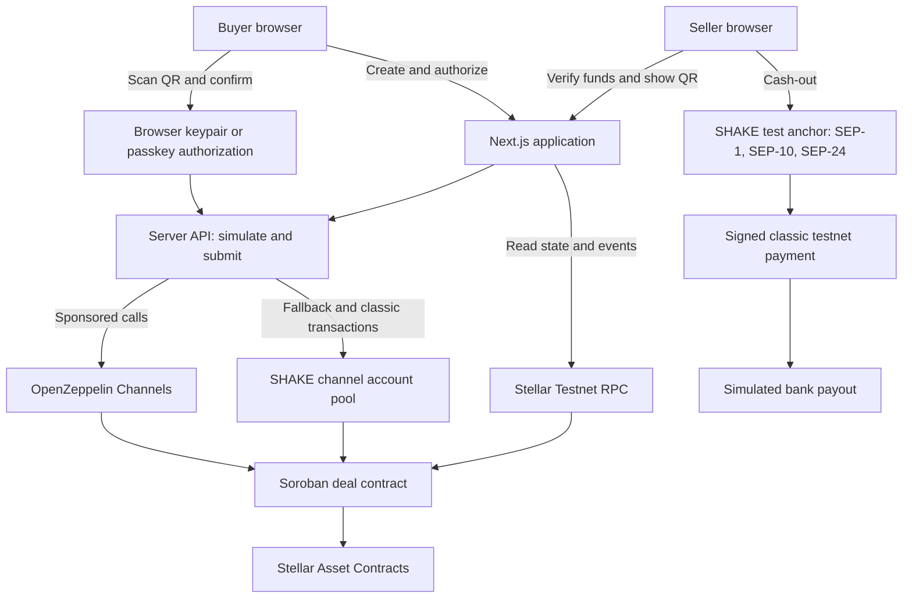
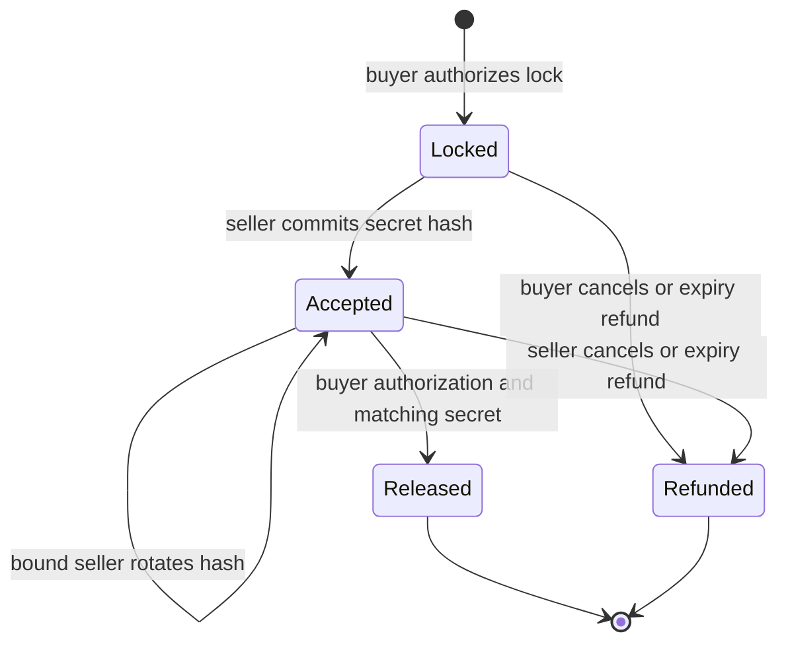

<div align="center">


**Arrange the deal anywhere. Verify the funds. Pay at the handover.**

Built for HackMeridian 2026 · Genesis · Stellar Composed

[Live demo](https://shake-lake.vercel.app/) · [Judge walkthrough](#try-shake) · [Features](#features) · [Architecture](#architecture) · [Run locally](#run-locally) · [On-chain proof](#on-chain-proof)

</div>

---

## A screenshot is not a payment

You find a second-hand phone, agree on a price, and arrange to meet. Then comes the uncomfortable part: who goes first? The buyer does not want to pay before seeing the item. The seller does not want to hand it over on the strength of a payment screenshot.

**SHAKE gives both people something they can verify.** The buyer locks test funds in a Stellar smart contract. The seller checks the actual contract state. At the meetup, the buyer inspects the item, scans the seller's one-time QR, and confirms payment. If the deal falls through, the contract provides a refund path.

SHAKE is a payment companion for deals arranged on OLX, Vinted, Facebook Marketplace, WhatsApp, or any other channel. A shareable link connects the conversation to the payment; no marketplace integration is required.

> **Testnet MVP.** All balances and transactions use Stellar Testnet assets with no monetary value. The cash-out flow makes a real testnet transfer; its bank payout is explicitly simulated.

## How it works

| Step | Buyer | Seller |
| --- | --- | --- |
| **Lock** | Enter the item and amount. Lock funds for a deal with a 24-hour expiry. | Receive the deal link in the chat you already use. |
| **Verify** | Keep the funds committed while arranging the handover. | Verify the amount and live on-chain status. Join to generate a handshake QR. |
| **Meet** | Inspect the item and scan the QR, or enter the code underneath it. | Show the QR on your own phone. |
| **Shake** | Hold to confirm, or use the supported phone-bump gesture after code verification. | Wait for your own screen to confirm release before handing over the item. |
| **Keep the proof** | Open a public receipt with transaction links. | See the same settlement and optionally try testnet cash-out. |

Before a seller joins, the buyer can cancel. After acceptance, the seller can cancel and refund the buyer. Once the expiry passes, anyone can submit a refund returning the funds to the buyer. Expiry makes a refund available; a transaction must still be submitted.

## Try SHAKE

### One device: the pitch is the product

Open the [live SHAKE demo](https://shake-lake.vercel.app/).

1. Choose **Try it now · lock €5**. SHAKE creates a browser wallet, funds it with test euros, locks the funds, and joins using the team's seller account.
2. Watch the real setup steps complete. No wallet extension or manual XLM funding is needed.
3. **Hold to shake** to release the test funds, or choose **Not yet, give it back** for a seller-authorized refund.
4. Inspect the reveal: wallet creation, lock, acceptance, and settlement appear with transaction evidence.

The introduction is a working transaction flow. The judge participates in the product before reaching its explanation.

### Two devices: complete a second-hand deal

1. **Buyer:** open [the two-device demo](https://shake-lake.vercel.app/try), create a deal such as “Nintendo Switch” for 12 test euros, and share its link.
2. **Seller:** open the link on another phone or in a separate browser profile. Check the funds, then choose **I'm meeting them**.
3. **Seller:** show the generated QR and its readable handshake code.
4. **Buyer:** open the scanner from the deal, scan the QR, and confirm release. If camera access is unavailable, type the code.
5. **Both:** watch the deal settle and inspect `/r/<deal-id>` for the receipt.
6. **Seller, optional:** try **Shake to Bank** with test bank details to follow the withdrawal flow.

Use separate browser profiles because wallets are stored on each device. For phone testing, serve the app over HTTPS for camera and passkey access. Localhost also works for desktop testing. Confirmation time depends on testnet and relayer conditions; the project's build notes record roughly 6–10 seconds per transaction step.

## Features

### Payments and verification

- **Real contract settlement:** lock, accept, release, and refund operate on Stellar Testnet.
- **Shareable deals:** links, short deal codes, and item-aware social previews fit existing conversations.
- **Seller verification:** deal screens read the contract's amount, participants, expiry, and status rather than trusting an uploaded image.
- **QR handshake:** seller acceptance commits a SHA-256 hash; release requires buyer authorization and the matching secret.
- **QR rotation:** the bound seller can replace the committed hash before settlement, invalidating the previous code.
- **Refund controls:** buyer cancellation before acceptance, seller cancellation after acceptance, and permissionless refund submission after expiry.
- **Public receipts:** transaction hashes, timestamps, and Stellar Expert links expose the deal's on-chain history.

### Accounts, currencies, and cash-out

- **Instant browser wallets:** a local keypair supports the no-sign-up demo, with account reserves and trustlines sponsored by the application.
- **Optional passkey accounts:** compatible browsers can create an OpenZeppelin smart account through `smart-account-kit` and authorize with a passkey, including Face ID or Touch ID where supported.
- **Sponsored fees:** OpenZeppelin Channels handles Soroban submissions, with an application-funded channel pool as a fallback. Users do not need to obtain XLM.
- **Four test currencies:** tEUR, tUSD, tGBP, and tBRL, with country selection and locale-aware formatting. These are independently issued test assets; no foreign-exchange conversion is implemented.
- **Shake to Bank:** built-in SEP-1 discovery, SEP-10 authentication, and SEP-24 interactive withdrawals, including IBAN checksum validation, a signed testnet payment, and a simulated bank payout. The current cash-out client uses the seller's browser keypair.

### Product experience

- **Graphite Glacier design:** graphite surfaces, glacier-blue payment states, Satoshi typography, frosted glass, and a split-coin identity that closes at settlement.
- **Deliberate confirmation:** hold-to-shake and optional motion-triggered confirmation after code verification, with haptics where available.
- **Live updates and recovery:** polling aligns both devices with contract state; manual code entry provides a camera fallback.
- **Mobile presentation:** safe-area layouts, reduced-motion support in signature animations, an app manifest, and generated app icons.
- **Public activity APIs:** recent contract events power payment statistics and address activity summaries over a bounded three-day lookback. These are activity signals, not identity verification or permanent reputation records.

## Why this approach

**The payment fits the handover.** The buyer commits funds before meeting but authorizes release after inspecting the item. The seller can verify that commitment before making the trip.

**The proof is inspectable.** Receipts link to public transactions. SHAKE translates contract state into a consumer interface while leaving the evidence accessible.

**Distribution starts with a link.** People keep their existing listings and conversations. The proposed commercial model is a fee on protected deals; the MVP does not implement a production fee model or claim marketplace partnerships.

**Stellar components serve one user journey.** Soroban controls settlement, Stellar Asset Contracts carry test currencies, passkeys authorize smart accounts, sponsorship removes manual network funding, and an anchor flow demonstrates withdrawal.

## Architecture



| Layer | Implementation | Responsibility |
| --- | --- | --- |
| Web application | Next.js 15, React 19, TypeScript | Deal creation, verification, scanner, settlement, receipts, and interactive introduction. |
| Interface | Tailwind CSS 4, Motion, custom components | Responsive layouts, glass surfaces, transitions, and confirmation interactions. |
| Authorization | Stellar SDK 16.3.x; `smart-account-kit` 0.8.x | Sign with a browser keypair or optional passkey smart account. |
| Server orchestration | Next.js route handlers; Stellar SDK | Sponsor onboarding, simulate calls, relay authorizations, and read state and events. |
| Settlement | Rust; `soroban-sdk` 29.0.1 | Hold tokens, bind the seller, verify the secret, and enforce terminal settlement states. |
| Assets | Classic test assets wrapped as Stellar Asset Contracts | Transfer test currency through the contract's token interface. |
| Sponsorship | OpenZeppelin Channels; 24 derived channel accounts | Submit transactions and pay fees without user-held XLM. |
| Test anchor | Application-owned SEP endpoints | Discover services, authenticate a classic account, and demonstrate withdrawals. |

The MVP uses on-chain deal storage, browser-local wallet/session data, signed withdrawal tokens, and an in-memory event cache. It requires no external application database. Stellar Testnet RPC serves contract reads and submissions; Horizon supports the anchor's transaction lookup.

### Contract lifecycle



The escrow implementation is in [`contracts/escrow/src/lib.rs`](contracts/escrow/src/lib.rs).

| Method | Contract behavior |
| --- | --- |
| `lock(buyer, token, amount, deal_id, expiry, memo)` | Requires buyer authorization, positive amount, future expiry, unused ID, and a memo of at most 64 bytes. Transfers tokens into the contract. |
| `accept(deal_id, seller, hash)` | Requires seller authorization, an open unexpired deal, and a seller distinct from the buyer. Binds the seller; only that seller can rotate the hash. |
| `release(deal_id, secret)` | Requires buyer authorization, accepted status, and a matching SHA-256 preimage. Transfers funds to the bound seller. |
| `refund(deal_id)` | Returns funds to the buyer. Before expiry, requires the buyer if unaccepted or the seller if accepted; after expiry, anyone may submit it. |
| `get(deal_id)` | Returns participants, token, amount, expiry, memo, hash, and status. |

State-changing operations emit events. Deal records use persistent storage with TTL extension on writes. Released and refunded deals cannot settle again.

### What the handshake guarantees

The contract verifies **buyer authorization plus knowledge of the seller's committed secret**. This supports a face-to-face handover flow, but a QR or code can be shared remotely; it is not an independent proof of physical proximity. Phone motion is a confirmation gesture, not an on-chain security input.

The contract does not inspect the item, arbitrate disputes, or reverse a completed release. Currently, `release` does not check expiry: after expiry, release and refund remain possible until one transaction settles the deal. There is no background refund scheduler in this repository.

The browser-keypair path stores its signing key in local storage. Passkeys provide a separate smart-account authorization path. Server-held issuer, sponsor, and team keys support test funding, sponsorship, and the single-device demo. This is a hackathon implementation, not an audited production payment service.

## On-chain proof

Public deployment identifiers from the repository's local configuration at the time of this README update:

| Component | Stellar Testnet identifier |
| --- | --- |
| Deal contract | [`CBPJPV7RBCC5WXB7BNLOYULIDMLECOSPBRGVYCLPU7PX6C6VQBWFQRVS`](https://stellar.expert/explorer/testnet/contract/CBPJPV7RBCC5WXB7BNLOYULIDMLECOSPBRGVYCLPU7PX6C6VQBWFQRVS) |
| tEUR contract | [`CCFUCVE7557QSF3HPM26D6CNBNZINFGHH7LERSZXVBCAV6KYRYIVPTAR`](https://stellar.expert/explorer/testnet/contract/CCFUCVE7557QSF3HPM26D6CNBNZINFGHH7LERSZXVBCAV6KYRYIVPTAR) |
| tUSD contract | [`CB2566JZPAWMJJ7M3HQONF5S7F7PKSNTAO46KCUTEPS6OSLKPV4LQT5K`](https://stellar.expert/explorer/testnet/contract/CB2566JZPAWMJJ7M3HQONF5S7F7PKSNTAO46KCUTEPS6OSLKPV4LQT5K) |
| tGBP contract | [`CDE7CPLXT5RXLQAOXQ6HHVFYBZKNSWJ2IRKAON5VQFWIEJ4BE32HKD7M`](https://stellar.expert/explorer/testnet/contract/CDE7CPLXT5RXLQAOXQ6HHVFYBZKNSWJ2IRKAON5VQFWIEJ4BE32HKD7M) |
| tBRL contract | [`CD7MJRLVFP3HOUX2YNI2DYOWU4QFZJ3ON5JVLFE3C3LOZVIGCOH7PGBT`](https://stellar.expert/explorer/testnet/contract/CD7MJRLVFP3HOUX2YNI2DYOWU4QFZJ3ON5JVLFE3C3LOZVIGCOH7PGBT) |
| Test asset issuer | [`GD2U4G7UTP2356O4HAVWMICIOHJZYNBKPLQNXJ4HUBRBDYRXWSR552QJ`](https://stellar.expert/explorer/testnet/account/GD2U4G7UTP2356O4HAVWMICIOHJZYNBKPLQNXJ4HUBRBDYRXWSR552QJ) |
| Pitch seller | [`GANMRJYUDGU4UJBDPV2JOMEOIXFG2TIM2WC7EV5ZDQFWBLQZ5OVULLQX`](https://stellar.expert/explorer/testnet/account/GANMRJYUDGU4UJBDPV2JOMEOIXFG2TIM2WC7EV5ZDQFWBLQZ5OVULLQX) |

The [build log](docs/plan.md) records an earlier deployment's smoke-test sequence: [lock](https://stellar.expert/explorer/testnet/tx/f0e4a08c9bec79c6273bea16458bccd0fcfa0c0d7839c931d1dfd0ec309f8abc), [seller acceptance](https://stellar.expert/explorer/testnet/tx/b95ffd9a34ac3c248dc3c140c9b9084ae45f3eff3a362f00cffadc1eac5cf3d5), and [release](https://stellar.expert/explorer/testnet/tx/a1e47d96dea9ec1a87d1e0a5cb695cf39645079afd25f2756f0cf61f6db48956). These are historical evidence, not a fresh verification against the current contract. For a new run, follow the transaction links in its live receipt. Testnet resets and redeployments can invalidate older identifiers.

## Run locally

### Prerequisites

- Node.js 20.9 or later and npm.
- Rust, Cargo, the `wasm32v1-none` target, and a Stellar CLI compatible with the contract SDK. The project's recorded CLI is 28.1.0.
- Bash for deployment scripts; on Windows, use Git Bash or WSL with the required tools available.
- Access to Stellar Testnet RPC, Horizon, and Friendbot. An OpenZeppelin Channels testnet API key is optional because the application includes its own sponsored submission fallback.

### 1. Install

```bash
git clone https://github.com/franciscogfsm/shake.git
cd shake
npm ci
cp .env.example .env.local
rustup target add wasm32v1-none
```

### 2. Deploy your testnet environment

```bash
bash scripts/deploy.sh
bash scripts/currencies.sh
node scripts/channels.mjs
```

Run these in order. The deployment script creates and funds issuer, sponsor, and team accounts, deploys tEUR and the deal contract, and writes IDs and secret keys to `.env.local`. The currency script deploys the other assets and adds the team's trustlines. The final script creates the 24 channel accounts required by onboarding and fallback submissions.

Re-running the full deployment creates fresh identities and replaces generated configuration. To redeploy only the deal contract while retaining accounts and assets:

```bash
CONTRACT_ONLY=1 bash scripts/deploy.sh
```

### 3. Start the application

```bash
npm run dev -- --port 3100
```

Open [localhost:3100](http://localhost:3100) for the introduction or [localhost:3100/try](http://localhost:3100/try) for the two-device flow.

### Environment variables

Public variables are embedded in the client bundle by Next.js. Set them before building and restart the development server after changing them. Generated values come from the scripts above; another deployment's public addresses alone are insufficient to configure its server operations.

| Variable | Purpose | Supplied by |
| --- | --- | --- |
| `NEXT_PUBLIC_NETWORK` | Deployment label (`testnet`); passphrase and endpoints are fixed in code. | `deploy.sh` |
| `NEXT_PUBLIC_DEAL_CONTRACT_ID` | Deal contract address. | `deploy.sh` |
| `NEXT_PUBLIC_TOKEN_CONTRACT_ID` | Default tEUR contract; also used by legacy scripts. | `deploy.sh` |
| `NEXT_PUBLIC_TOKEN_EUR` | Explicit tEUR contract; falls back to `NEXT_PUBLIC_TOKEN_CONTRACT_ID`. | `currencies.sh` |
| `NEXT_PUBLIC_TOKEN_USD` | tUSD contract. | `currencies.sh` |
| `NEXT_PUBLIC_TOKEN_GBP` | tGBP contract. | `currencies.sh` |
| `NEXT_PUBLIC_TOKEN_BRL` | tBRL contract. | `currencies.sh` |
| `NEXT_PUBLIC_TOKEN_ISSUER` | Public issuer of test assets. | `deploy.sh` |
| `NEXT_PUBLIC_TEAM_ADDRESS` | Public seller for the introduction. | `deploy.sh` |
| `ISSUER_SECRET` | Server-only key for issuing test funds. | `deploy.sh` |
| `SPONSOR_SECRET` | Server-only reserve sponsor; derives channels and anchor signing material. | `deploy.sh` |
| `TEAM_SECRET` | Server-only seller key for pitch acceptance and cancellation. | `deploy.sh` |
| `CHANNELS_API_KEY` | Optional OpenZeppelin Channels sponsorship key. | Developer configuration |
| `NEXT_PUBLIC_SITE_URL` | Optional canonical origin for metadata and social previews. | Developer configuration |

Keep `.env.local` private. The passkey account WASM hash and WebAuthn verifier address are public constants in [`src/lib/config.ts`](src/lib/config.ts). Changing `NEXT_PUBLIC_NETWORK` alone does not switch networks.

### Production build

```bash
npm run build
npm run start -- --port 3100
```

For Vercel, configure the same public IDs and server-only variables before building, and set `NEXT_PUBLIC_SITE_URL` to the public HTTPS origin. A hosted production build still uses Stellar Testnet and does not enable real-money payments.

## Validation

| Command | Scope |
| --- | --- |
| `npm run lint` | ESLint checks. |
| `npm run build` | Next.js production compilation and build checks. |
| `cargo test --manifest-path contracts/escrow/Cargo.toml` | Contract unit tests. |
| `npm run e2e -- http://localhost:3100` | Testnet onboarding, buyer/seller settlement, wrong-secret rejection, and pitch release. |
| `node scripts/anchor-e2e.mjs http://localhost:3100` | Anchor discovery, authentication, IBAN validation, payment, and withdrawal completion. |
| `node scripts/ui-flow.cjs http://localhost:3100 <existing-output-directory>` | Playwright two-browser walkthrough with a virtual passkey authenticator and screenshots. Requires Playwright Chromium. |
| `npm run commits` | Refresh the commit-history data used to document development progress. |

The contract suite covers custody, authorized release, wrong secrets, QR rotation, repeated settlement, cancellation permissions, post-expiry refunds, expired acceptance, seller binding, self-dealing, invalid inputs, and memo bounds. Testnet and UI scripts require a running, fully configured application and submit actual testnet transactions. These are available checks, not a claim that every check was rerun for this documentation update.

## Project map

```text
contracts/escrow/       Rust deal contract and unit tests
src/app/               App Router screens, metadata, and server API routes
src/app/api/anchor/     Authentication and withdrawal endpoints
src/components/        Payment controls, QR scanner, receipts, and visual system
src/lib/client/        Wallets, passkeys, handshake codes, polling, and pitch session
src/lib/server/        Stellar orchestration, event index, and test anchor
src/lib/config.ts      Network constants, assets, currencies, and explorer links
scripts/               Deployment, channels, currencies, and end-to-end checks
docs/                  Build context, design system, research, and integration notes
design/reference.html  Graphite Glacier visual reference
```

Useful entry points: [design system](docs/design-system.md), [technical research](docs/research.md), [pitch integration](docs/pitch-integration.md), and [build plan](docs/plan.md). The plan contains historical milestones; source code is the reference for the implementation described here.

## Built for HackMeridian

SHAKE is developed by **Francisco and Pedro** for HackMeridian 2026 in Lisbon, targeting the **Genesis** builder track and **Stellar Composed** thematic track.

The project combines its own Soroban settlement contract with Stellar Asset Contracts, OpenZeppelin sponsorship, passkey smart accounts, and an application-owned test anchor. The goal is to make these components feel like one straightforward payment experience.

**Prior work disclosure:** the team's project context records ideation and planning documents before the event, with implementation intended for the hackathon. Git history is the evidence for implementation timing; `npm run commits` refreshes the in-app history.

---

<div align="center">

**Never trust a screenshot again. Shake on it.**

</div>
