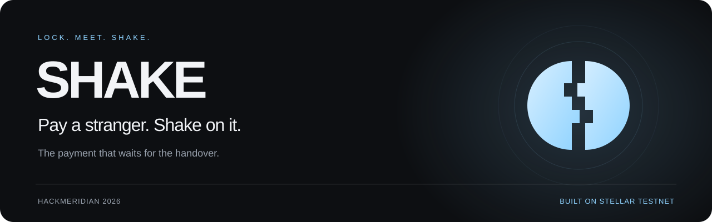
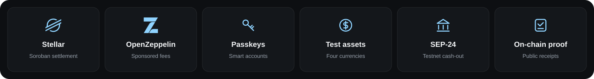
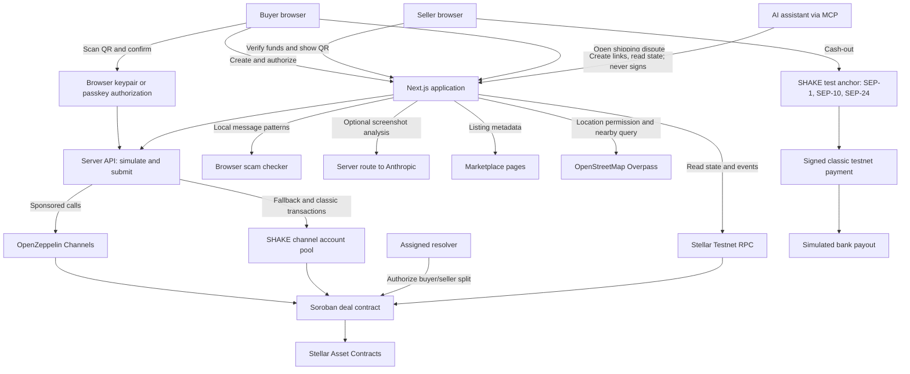
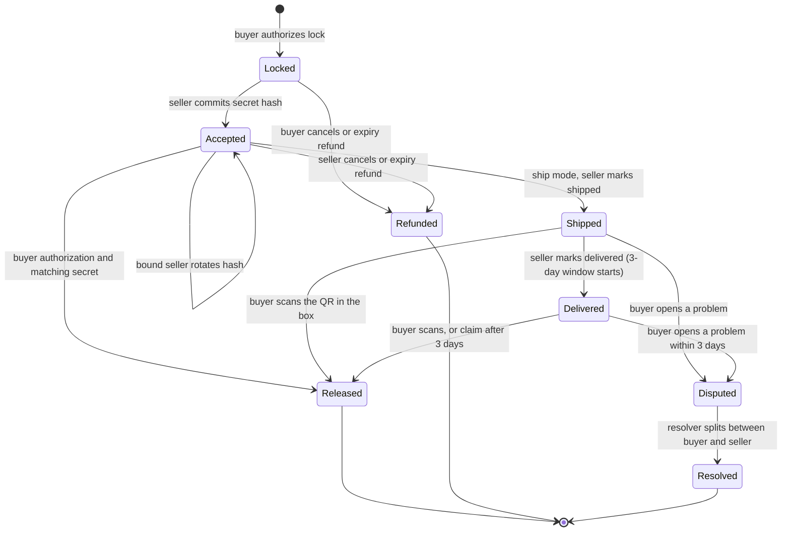

<div align="center">



**Arrange the deal anywhere. Verify the funds. Pay at the handover.**

Built for HackMeridian 2026 · Genesis · Stellar Composed

Implementation reviewed against the local source on **25 October 2026**. Hosted features depend on deployment configuration.



[Launch SHAKE](https://shake-lake.vercel.app/) · [Judge walkthrough](#try-shake) · [Marketplace extension](#shake-on-marketplace-listings) · [Features](#features) · [Anti-scam tools](#anti-scam-tools) · [Architecture](#architecture) · [Run locally](#run-locally) · [On-chain proof](#on-chain-proof)

</div>

---

## A screenshot is not a payment

You find a second-hand phone, agree on a price, and arrange to meet. Then comes the uncomfortable part: who goes first? The buyer does not want to pay before seeing the item. The seller does not want to hand it over on the strength of a payment screenshot.

**SHAKE gives both people something they can verify.** The buyer locks test funds in a Stellar smart contract. The seller checks the actual contract state. At the meetup, the buyer inspects the item, scans the seller's one-time QR, and confirms payment. If the deal falls through, the contract provides a refund path.

SHAKE is a payment companion for deals arranged on OLX, Vinted, Facebook Marketplace, WhatsApp, or any other channel. A shareable link connects the conversation to the payment; no marketplace integration is required. Buyers can meet in person or choose shipping, with a QR inside the package and a dispute window after delivery. Before committing, either person can check suspicious messages, inspect public deal activity, and find nearby public meetup places.

> **Live on Stellar Testnet · Test mode.** Wallet creation, escrow, settlement, refunds, and transaction proofs run against the live test network. Test assets have no cash value. The bank withdrawal integration submits a real testnet transfer to the anchor; its final bank payout runs in a sandbox and does not credit a bank account.

## SHAKE on marketplace listings

**A listing becomes a SHAKE payment.** The desktop Chrome/Edge extension adds **Pay safely with SHAKE** to listing pages on Vinted, OLX, Wallapop, Depop, eBay, Etsy, Gumtree, Leboncoin, Marktplaats, Kleinanzeigen, Facebook Marketplace, Mercari, Poshmark, OfferUp, Craigslist, and Carousell. Its isolated panel reads the title, price, and currency, lets the buyer review or edit them, then opens a prefilled SHAKE payment with a link to the original listing.

[Install SHAKE for marketplaces](https://shake-lake.vercel.app/extension) · [Extension source and installation guide](extension/README.md)

For the judge walkthrough, load the repository's `extension` folder through **chrome://extensions → Developer mode → Load unpacked**, refresh a supported listing, select **Pay safely with SHAKE**, and continue into the payment form. For other shops, the pinned toolbar action reads the current product page on demand. No money moves until the buyer explicitly locks funds in SHAKE. The seller still needs to agree to use SHAKE and join the shared deal.

Extraction uses Product JSON-LD, Open Graph metadata, and visible listing fields. Marketplace layouts, regional domains, and prices vary; users confirm imported details. EUR, USD, GBP, and BRL test settlement assets are supported. Unsupported currencies require an explicit agreed amount; there is no FX conversion. The extension is independent of these marketplaces and does not verify sellers or inherit their buyer protection. Local unpacked installation is required; there is no Web Store release yet. Chromium fixtures verify the implementation; fixture coverage does not guarantee every live listing.

## How it works

| Step | Buyer | Seller |
| --- | --- | --- |
| **Lock** | Enter the item and amount. Lock funds for a deal with a 24-hour expiry. | Receive the deal link in the chat you already use. |
| **Verify** | Keep the funds committed while arranging the handover. | Verify the amount and live on-chain status. Join to generate a handshake QR. |
| **Meet** | Inspect the item and scan the QR, or enter the code underneath it. | Show the QR on your own phone. |
| **Shake** | Hold to confirm, or use the supported phone-bump gesture after code verification. | Wait for your own screen to confirm release before handing over the item. |
| **Keep the proof** | Open a public receipt with transaction links. | See the same settlement and optionally try testnet cash-out. |

For meetup deals, before a seller joins, the buyer can cancel. After acceptance, the seller can cancel and refund the buyer. Once the expiry passes, anyone can submit a refund returning the funds to the buyer. Expiry makes a refund available; a transaction must still be submitted. Shipping has a separate lifecycle: once marked shipped, funds can only be released or settled through the dispute process described below.

## Try SHAKE

### One device: the pitch is the product

Open the [live SHAKE application](https://shake-lake.vercel.app/).

1. Choose your payment currency in the region picker, then select **Try it now** to lock 5 units. SHAKE creates a browser wallet, funds it with that test asset, locks the funds, and joins using the team's seller account. Saved payment sessions retain their original currency.
2. Watch the real setup steps complete. No wallet extension or manual XLM funding is needed.
3. **Hold to shake** to release the test funds, or choose **Not yet, give it back** for a seller-authorized refund.
4. Inspect the reveal: wallet creation, lock, acceptance, and settlement appear with transaction evidence.

The introduction is a working transaction flow. The judge participates in the product before reaching its explanation.

### Two devices: complete a second-hand deal

1. **Buyer:** open [the two-device experience](https://shake-lake.vercel.app/try), create a deal such as “Nintendo Switch” for 12 test euros, select **We'll meet**, and share its link. New deals accept 1–2,000 units with up to two decimal places. Compatible browsers offer passkey authorization; **Lock without Face ID** uses the browser keypair.
2. **Seller:** open the link on another phone or in a separate browser profile. Check the funds, then choose **I'm meeting them, show my QR**. The seller can also enter the short deal code under **I'm selling** on `/try`.
3. **Seller:** show the generated QR and its readable handshake code.
4. **Buyer:** open the scanner from the deal, scan the QR, and confirm release. If camera access is unavailable, type the code.
5. **Both:** watch the deal settle and inspect `/r/<deal-id>` for the receipt.
6. **Seller, optional:** try **Shake to Bank** with test bank details to follow the withdrawal flow.

Use separate browser profiles because wallets are stored on each device. For phone testing, serve the app over HTTPS for camera and passkey access. Localhost also works for desktop testing. Confirmation time depends on testnet and relayer conditions; the project's build notes record roughly 6–10 seconds per transaction step.

### Shipped deal: the shake travels in the box

1. **Buyer:** create a deal at `/deal/new` and select **It's shipped**. The app sets a 14-day pre-shipment expiry and assigns the SHAKE team address as resolver.
2. **Seller:** open the shared link, join, and print the QR or write its readable code on a note inside the package. Enter optional tracking text and choose **I've shipped it**.
3. **Seller:** mark the package delivered when it arrives. This starts the three-day buyer review window. Shipment and delivery are seller declarations; there is no carrier tracking integration.
4. **Buyer:** inspect the package, then scan the enclosed QR and confirm release. If there is a problem, choose **Open a problem** while shipped or before the delivery review window ends. Disputing freezes settlement.
5. **Seller:** if no dispute is opened, choose **Release my money** when the three-day window ends. The contract permits anyone to submit this claim; no background service submits it automatically.
6. **Resolver:** settle a disputed deal with `node scripts/resolve.mjs <deal-id> <amount-to-buyer>`. The amount is in the deal's own test currency, not a currency conversion. The script signs with `TEAM_SECRET`; the contract sends the chosen amount to the buyer and the remainder to the seller.

Before shipment, the usual cancellation permissions apply: the buyer can cancel before acceptance, the bound seller can cancel after acceptance, and anyone can refund after expiry. After shipment, expiry does not unlock a refund. A shipped deal needs buyer release, delivery followed by a claim, or a dispute resolved by the assigned resolver.

### Use SHAKE from any AI assistant (MCP)

SHAKE is an MCP server at `https://shake-lake.vercel.app/api/mcp` (Streamable HTTP, no auth). Add it as a custom connector in Claude or ChatGPT, or in Cursor (`{"mcpServers":{"shake":{"url":"https://shake-lake.vercel.app/api/mcp"}}}`).

| Tool | What it does |
| --- | --- |
| `protect_purchase` | Returns a prefilled deal link the buyer opens to lock the money; optionally scans the seller's message. |
| `check_seller_message` | Runs the same scam patterns as `/check` on a pasted chat message. |
| `verify_payment` | "Did they really pay me?", answered from the contract's state on testnet, not a screenshot. |
| `deal_status` | Status, parties, and every transaction with Stellar Expert links. |
| `find_safe_spot` | Public meeting places near an address (Nominatim + Overpass). |
| `create_payment_request` | A reusable request link for a seller or small business. |
| `release_payment` | Always refuses, and explains why. |

**Agents can create links and read state; they can never move money.** The endpoint holds no user keys and signs nothing. Release still needs the buyer's passkey or browser key plus the seller's one-time QR secret, in person. Try: *"Someone on Vinted wants €60 for a jacket, here's his message, is it safe?"*, then *"Release the money."*

### Try the anti-scam check

Open [Scam check](https://shake-lake.vercel.app/check) without creating a wallet. Use the built-in **MB WAY request**, **Fake link**, or **Screenshot** examples, or paste `Envio-te um pedido de dinheiro no MB WAY, é só aceitar` to see the request-money warning. Paste a SHAKE deal link or short code to open its public receipt. The **Screenshot** button uses optional server-side vision; message checking works without an API key.

## Features

### Payments and verification

- **Real contract settlement:** lock, accept, release, and refund operate on Stellar Testnet.
- **Shareable deals:** links, short deal codes, and item-aware social previews fit existing conversations.
- **Seller verification:** deal screens read the contract's amount, participants, expiry, and status rather than trusting an uploaded image.
- **QR handshake:** seller acceptance commits a SHA-256 hash; release requires buyer authorization and the matching secret.
- **QR rotation:** the bound seller can replace the committed hash before settlement, invalidating the previous code.
- **Refund controls:** buyer cancellation before acceptance, seller cancellation after acceptance, and permissionless refund submission after expiry.
- **Ship mode:** QR in the package, optional tracking text, shipment and delivery states, a three-day review window, permissionless claims after that window, and buyer disputes with resolver-controlled splits. See the [shipping walkthrough](#shipped-deal-the-shake-travels-in-the-box).
- **Public receipts:** transaction hashes, timestamps, and Stellar Expert links expose the deal's on-chain history.

### Anti-scam and deal preparation

- **Scam check (`/check`):** Portuguese and English message patterns, danger/warning results, plain-language explanations, and checks for suspicious brand domains. Text is checked locally without an API key.
- **Optional screenshot analysis:** upload a payment or chat screenshot for Claude vision to flag suspicious details. If reading is unavailable, the page explains that a screenshot cannot prove payment and offers the text checker.
- **Verify a deal from a message:** recognized SHAKE links and short codes lead to the public receipt so the recipient can check the actual deal.
- **Public track record (`/u/[address]`):** deals locked, released, and attributed cancellations counted from recent contract events, for classic and smart-account addresses. The window is three days.
- **Listing title autofill:** paste an HTTPS OLX or Vinted listing into the item field. The listing API also accepts Wallapop and Depop hosts, extracts available title/price metadata, and falls back to the URL slug for the title. The form fills a price only when the response identifies the selected currency; the current API does not return a currency, so enter the price manually.
- **Nearby meetup suggestions:** on request, geolocation finds police stations, shopping centres, railway stations, libraries, and town halls within 2 km using OpenStreetMap's Overpass API. Up to five suggestions are shown, prioritizing police stations, with distances and Google Maps links. Location-denied, empty, and network-error states offer manual guidance.

### Accounts, currencies, and cash-out

- **Instant browser wallets:** a local keypair supports the no-sign-up experience, with account reserves and trustlines sponsored by the application.
- **Optional passkey accounts:** compatible browsers can create an OpenZeppelin smart account through `smart-account-kit` and authorize with a passkey, including Face ID or Touch ID where supported.
- **Sponsored fees:** OpenZeppelin Channels handles Soroban submissions, with an application-funded channel pool as a fallback. Users do not need to obtain XLM.
- **Worldwide region preferences:** 249 countries and territories, browser locale detection, and separate region, number-format, and payment-currency controls. Preferences are remembered across pages and tabs.
- **Four test currencies:** tEUR, tUSD, tGBP, and tBRL, carried through testnet funding, escrow, and receipts. Locale-aware entry supports decimal commas, grouping, and Arabic, Persian, Indian, and full-width numerals. Invalid precision is rejected before funding. Totals remain separate for each asset. These are independently issued test assets; no foreign-exchange conversion is implemented.
- **Shake to Bank:** built-in SEP-1 discovery, SEP-10 authentication, and SEP-24 interactive withdrawals, including IBAN checksum validation, a signed testnet payment, and a simulated bank payout. The current cash-out client uses the seller's browser keypair. Worldwide region selection does not imply local fiat or bank payout coverage; real payouts need an anchor supporting the destination and currency.

### Product experience

- **Graphite Glacier design:** graphite surfaces, glacier-blue payment states, Satoshi typography, frosted glass, and a split-coin identity that closes at settlement.
- **Deliberate confirmation:** hold-to-shake and optional motion-triggered confirmation after code verification, with haptics where available.
- **Live updates and recovery:** polling aligns both devices with contract state; manual code entry provides a camera fallback. Seller QR codes survive refresh on the same browser. The saved one-device payment session reconciles with the chain before settlement, including after a lost response, and retains its original currency.
- **Sharing and proof:** native sharing with clipboard fallback, readable deal codes, item-aware social cards for deal/receipt links, and proof links that briefly wait for explorer indexing.
- **Mobile presentation:** safe-area layouts, reduced-motion support in signature animations, an app manifest, and generated app icons.
- **Public activity APIs:** recent contract events power payment statistics and address activity summaries over a bounded three-day lookback. These are activity signals, not identity verification or permanent reputation records.

## Anti-scam tools

SHAKE combines checks before a deal with verification during payment. The message checker highlights known patterns; the deal screen and receipt read actual contract state.

| Message signal | What the checker flags |
| --- | --- |
| MB WAY request-money language | Requests or codes presented as a step to receive a payment. |
| SMS codes, PINs, or OTPs | Someone asking for a code from the recipient's phone. |
| “Click to receive” links | A link presented as necessary to collect money. |
| Courier payment requests | Courier names alongside payment, fee, or confirmation language. |
| Payment screenshots or “already paid” claims | A picture or message offered as proof instead of independently checked funds. |
| Urgency | Pressure to act immediately or miss the deal. |
| Moving off-platform | Certain requests to continue via messaging or email. |
| Overpayment | Paying extra and asking for the difference back. |
| Look-alike domains | OLX, Vinted, MB WAY, CTT, or SHAKE names in a host outside the checker's configured official domains. |

The checker returns **danger**, **warn**, or **clear**, with an explanation for each matched signal. It uses Portuguese and English regular expressions and a configured domain list. A clear result means no configured pattern matched; it does not authenticate a sender, certify a website, or prove that money arrived. The UI currently accepts up to 2,000 message characters.

**Data handling:** pasted message text stays in the browser. Choosing **Screenshot** sends the selected image to `/api/check`, which forwards it to Anthropic when `ANTHROPIC_API_KEY` is configured. The screenshot picker accepts PNG, JPEG, and WebP; the server also accepts GIF and rejects base64 payloads above 7,000,000 characters. No screenshot storage is implemented in the route. AI output is advisory, and failed or disabled analysis falls back to guidance and local text checking. Nearby-place lookup separately sends coordinates to Overpass only after requesting the user's location.

**Payment protection:** the seller checks the contract's amount and status; the current QR flow requires buyer authorization and the seller's matching secret. Codes for another deal and old or incorrect codes are rejected by the scanner or contract. Once accepted, another seller cannot replace the bound seller; that seller can rotate the QR before shipment or settlement. Shipping disputes stop QR release and the timed claim. The contract restricts a resolution to the original buyer and seller, so the resolver cannot redirect the funds to itself. Deposit and approval methods are described below.

Public track records describe recent address activity, not a verified person's identity. Cancellation attribution follows the implementation: the accepted seller, or the buyer if nobody accepted, is counted as having walked away even when a refund was submitted after expiry. Meetup suggestions come from map categories; the app does not verify opening hours, cameras, or the safety of a particular location.

## Current scope and roadmap

Meetup payments, shipping/disputes, local message checks, public activity, listing-title import, nearby-place lookup, four test currencies, passkey accounts, and the test anchor are implemented in this repository. Screenshot analysis additionally requires an Anthropic key and successful access to the model configured in `src/app/api/check/route.ts`; its presence in source does not confirm that a hosted deployment has enabled it.

Planned work includes Reflector price feeds, path-payment currency conversion, confidential tokens, Circle USDC/EURC, PWA push notifications, and a Portuguese/English interface switch. The current region picker changes monetary formatting and payment currency; it does not translate the interface. The app manifest does not provide an offline payment mode. Carrier-confirmed delivery and automated refund/claim scheduling are not implemented.

### Deal kinds and deposits

The new-deal form starts with **what the payment is for**: buying in person, buying shipped, a rental deposit (caução), a job or service, or a booking/hire deposit. Kinds only change wording and defaults (`src/lib/kinds.ts`); each maps to one of three contract rules: Meet (QR release), Ship (QR or approval, timed claim, disputes) and **Hold** (a deposit with an end date). Jobs use Ship mode: the professional marks the work started and done, and the client approves and pays (`approve`) or the timed claim applies. Deposits use Hold mode: the holder confirms, can return the deposit early or claim damage before the end date, and the payer can accept the claim with one tap. These methods are deployed and allowed by the server's contract-call allowlist:

| Method | Implemented contract behavior |
| --- | --- |
| `lock_hold(…, resolver)` | Locks a deposit with an end date and a resolver distinct from the payer and eventual holder. |
| `claim_damage(deal_id, amount)` | The bound holder claims a positive amount up to the deposit before expiry; the accepted deposit becomes disputed. |
| `agree(deal_id)` | The payer accepts a disputed deduction; the claimed amount goes to the holder and the remainder returns to the payer. |
| `refund(deal_id)` in Hold mode | An undisputed deposit can be returned by anyone after expiry. Before expiry, normal cancellation permissions apply. A holder can also withdraw a disputed claim and return the full deposit. |
| `resolve(deal_id, to_buyer)` | The assigned resolver splits a disputed deposit between payer and holder. |
| `approve(deal_id)` | Buyer-authorized full payment without a QR in non-Meet modes, including disputed status. Meet mode rejects it. The web app offers it for jobs. |

Expiry makes a deposit refund callable; it does not submit a transaction by itself. Contract tests for deposit returns, claims, agreed deductions, resolver splits, and deadline/mode restrictions accompany this work.

## Why this approach

**The payment fits the handover.** The buyer commits funds before meeting but authorizes release after inspecting the item. The seller can verify that commitment before making the trip.

**The proof is inspectable.** Receipts link to public transactions. SHAKE translates contract state into a consumer interface while leaving the evidence accessible.

**Distribution starts with a link.** People keep their existing listings and conversations. The proposed commercial model is a fee on protected deals; the MVP does not implement a production fee model or claim marketplace partnerships.

**Stellar components serve one user journey.** Soroban controls settlement, Stellar Asset Contracts carry test currencies, passkeys authorize smart accounts, sponsorship removes manual network funding, and an anchor flow demonstrates withdrawal.

## Architecture

The integration artwork uses the [Stellar](https://github.com/simple-icons/simple-icons/blob/develop/icons/stellar.svg) and [OpenZeppelin](https://github.com/simple-icons/simple-icons/blob/develop/icons/openzeppelin.svg) brand marks from Simple Icons. Passkeys, test assets, SEP-24, and receipts use custom capability icons.



| Layer | Implementation | Responsibility |
| --- | --- | --- |
| Web application | Next.js 15, React 19, TypeScript | Meetup/shipping deals, scanner, settlement, disputes, receipts, scam check, public profiles, and interactive introduction. |
| Interface | Tailwind CSS 4, Motion, custom components | Responsive layouts, glass surfaces, transitions, and confirmation interactions. |
| Authorization | Stellar SDK 16.3.x; `smart-account-kit` 0.8.x | Sign with a browser keypair or optional passkey smart account. |
| Server orchestration | Next.js route handlers; Stellar SDK | Sponsor onboarding, simulate calls, relay authorizations, and read state and events. |
| Settlement | Rust; `soroban-sdk` 29.0.1 | Hold tokens, bind the seller, verify the secret, enforce shipping/dispute windows, and settle release/refund/resolution. |
| Assets | Classic test assets wrapped as Stellar Asset Contracts | Transfer test currency through the contract's token interface. |
| Sponsorship | OpenZeppelin Channels; 24 derived channel accounts | Submit transactions and pay fees without user-held XLM. |
| Test anchor | Application-owned SEP endpoints | Discover services, authenticate a classic account, and demonstrate withdrawals. |
| Anti-scam checks | Local TypeScript patterns; optional Anthropic vision route | Explain suspicious messages/domains and optionally analyze screenshots. |
| Deal preparation | Listing metadata fetch; OpenStreetMap Overpass | Import item titles and suggest nearby public meeting places. |
| Activity | RPC contract-event index with a short-lived memory cache | Per-asset totals, recent activity, and three-day address track records. |

The MVP uses on-chain deal storage, browser-local wallet/session data, signed withdrawal tokens, and an in-memory event cache. It requires no external application database. Stellar Testnet RPC serves contract reads and submissions; Horizon supports the anchor's transaction lookup.

### Screens and API entry points

| Route | Purpose |
| --- | --- |
| `/` | One-device live payment flow, product explanation, live proof panel, and reveal. |
| `/try` | Two-device entry point: buy or open a seller deal code. |
| `/deal/new` | Item, amount, region/currency preferences, passkey choice, and meetup/shipping selection. |
| `/deal/[id]` | Buyer/seller views, verified funds, sharing, QR rotation, refunds, shipping, claims, and disputes. |
| `/scan/[id]` | QR/manual-code verification and deliberate buyer release. |
| `/r/[id]` | Public status, amount, participants, and core payment transaction timeline without signing in. |
| `/check` | Local message/domain checks, deal recognition, and optional screenshot analysis. |
| `/u/[address]` | Public three-day activity summary for an address. |
| `/anchor/withdraw` | Interactive test-anchor bank-details flow. |
| `GET /api/deal/[id]` | Contract state and available deal events. |
| `POST /api/call` | Prepare a contract call or submit its signed authorizations. |
| `POST /api/wallet`, `/api/passkey`, `/api/pitch` | Sponsored onboarding/funding, passkey funding, and team seller operations for the guided payment flow. |
| `GET /api/listing?url=…` | Supported marketplace title and available price extraction. |
| `POST /api/check` | Optional screenshot analysis; returns 501 when no API key is configured. |
| `POST /api/mcp` | MCP server for AI assistants: deal links, scam check, on-chain verification, safe spots. No signing. |
| `GET /api/stats`, `/api/reputation/[address]` | Recent contract activity, per-currency totals, and address counts. |
| `/.well-known/stellar.toml`, `/api/anchor/*`, `/api/wallet/pay` | Anchor discovery, authentication, withdrawal details/status, and signed payment preparation/submission. |

The public receipt displays all current status labels, including shipping and disputes, but its visual timeline currently focuses on lock, acceptance, release, and refund. Shipment, delivery, dispute, and resolution events are available from the contract/API; a complete shipping timeline is not yet rendered there.

### Contract lifecycle



The escrow implementation is in [`contracts/escrow/src/lib.rs`](contracts/escrow/src/lib.rs).

| Method | Contract behavior |
| --- | --- |
| `lock(buyer, token, amount, deal_id, expiry, memo)` | Requires buyer authorization, positive amount, future expiry, unused ID, and a memo of at most 64 bytes. Transfers tokens into the contract. |
| `accept(deal_id, seller, hash)` | Requires seller authorization, an open unexpired deal, and a seller distinct from the buyer. Binds the seller; only that seller can rotate the hash. |
| `release(deal_id, secret)` | Requires buyer authorization and a matching SHA-256 preimage while accepted, or while shipped/delivered in Ship mode. Transfers funds to the bound seller. |
| `refund(deal_id)` | Only while locked or accepted. Before expiry, requires the buyer if unaccepted or the seller if accepted; after expiry, anyone may submit it. Returns funds to the buyer. |
| `lock_ship(…, resolver)` | Same as `lock`, in Ship mode, naming the resolver. Rejects the buyer as resolver; acceptance rejects a seller who is the resolver. The app supplies `NEXT_PUBLIC_TEAM_ADDRESS`. |
| `mark_shipped(deal_id, tracking)` / `mark_delivered(deal_id)` | Bound seller only, Ship mode. After shipping the buyer can no longer refund. Delivery sets `release_after = now + 3 days`. |
| `claim(deal_id)` | Anyone, once a delivered deal passes `release_after`. Pays the seller. |
| `dispute(deal_id)` | Buyer only, while shipped or within 3 days of delivery. Freezes the deal. |
| `resolve(deal_id, to_buyer)` | Resolver only, on a disputed deal, with `0 <= to_buyer <= amount`. Sends `to_buyer` back and the rest to the seller. Use `node scripts/resolve.mjs <id> <amount-to-buyer>` in the deal's currency. |
| `get(deal_id)` | Returns participants, token, amount, expiry, memo, hash, status, mode, resolver, tracking, and release deadline. |

State-changing operations emit events. Deal records use persistent storage with TTL extension on writes. Released, refunded, and resolved deals cannot settle again.

### What the handshake guarantees

The contract verifies **buyer authorization plus knowledge of the seller's committed secret**. This supports a face-to-face handover flow, but a QR or code can be shared remotely; it is not an independent proof of physical proximity. Phone motion is a confirmation gesture, not an on-chain security input.

The contract does not inspect the item, confirm delivery with a carrier, decide disputes itself (the resolver splits them), or reverse a completed release. Currently, `release` does not check expiry: an accepted deal can still be released after expiry, competing with an eligible refund until one settles. Shipping refunds are unavailable after shipment. Seller-declared delivery starts the three-day claim window; a buyer must dispute before it ends. There is no background refund or claim scheduler in this repository.

The browser-keypair path stores its signing key in local storage. Passkeys provide a separate smart-account authorization path. Server-held issuer, sponsor, and team keys support test funding, sponsorship, and the single-device payment experience. This is a hackathon implementation, not an audited production payment service.

## On-chain proof

Public deployment identifiers from the repository's local configuration at the time of this README update:

| Component | Stellar Testnet identifier |
| --- | --- |
| Deal contract | [`CCHCT7HSKEOCFVOUPYHDAK4AOBIDIOVBXZDTL2XW7RTJJNGZGPDYYUKY`](https://stellar.expert/explorer/testnet/contract/CCHCT7HSKEOCFVOUPYHDAK4AOBIDIOVBXZDTL2XW7RTJJNGZGPDYYUKY) |
| tEUR contract | [`CCFUCVE7557QSF3HPM26D6CNBNZINFGHH7LERSZXVBCAV6KYRYIVPTAR`](https://stellar.expert/explorer/testnet/contract/CCFUCVE7557QSF3HPM26D6CNBNZINFGHH7LERSZXVBCAV6KYRYIVPTAR) |
| tUSD contract | [`CB2566JZPAWMJJ7M3HQONF5S7F7PKSNTAO46KCUTEPS6OSLKPV4LQT5K`](https://stellar.expert/explorer/testnet/contract/CB2566JZPAWMJJ7M3HQONF5S7F7PKSNTAO46KCUTEPS6OSLKPV4LQT5K) |
| tGBP contract | [`CDE7CPLXT5RXLQAOXQ6HHVFYBZKNSWJ2IRKAON5VQFWIEJ4BE32HKD7M`](https://stellar.expert/explorer/testnet/contract/CDE7CPLXT5RXLQAOXQ6HHVFYBZKNSWJ2IRKAON5VQFWIEJ4BE32HKD7M) |
| tBRL contract | [`CD7MJRLVFP3HOUX2YNI2DYOWU4QFZJ3ON5JVLFE3C3LOZVIGCOH7PGBT`](https://stellar.expert/explorer/testnet/contract/CD7MJRLVFP3HOUX2YNI2DYOWU4QFZJ3ON5JVLFE3C3LOZVIGCOH7PGBT) |
| Test asset issuer | [`GD2U4G7UTP2356O4HAVWMICIOHJZYNBKPLQNXJ4HUBRBDYRXWSR552QJ`](https://stellar.expert/explorer/testnet/account/GD2U4G7UTP2356O4HAVWMICIOHJZYNBKPLQNXJ4HUBRBDYRXWSR552QJ) |
| Pitch seller | [`GANMRJYUDGU4UJBDPV2JOMEOIXFG2TIM2WC7EV5ZDQFWBLQZ5OVULLQX`](https://stellar.expert/explorer/testnet/account/GANMRJYUDGU4UJBDPV2JOMEOIXFG2TIM2WC7EV5ZDQFWBLQZ5OVULLQX) |

The [build log](docs/plan.md) records an earlier deployment's smoke-test sequence: [lock](https://stellar.expert/explorer/testnet/tx/f0e4a08c9bec79c6273bea16458bccd0fcfa0c0d7839c931d1dfd0ec309f8abc), [seller acceptance](https://stellar.expert/explorer/testnet/tx/b95ffd9a34ac3c248dc3c140c9b9084ae45f3eff3a362f00cffadc1eac5cf3d5), and [release](https://stellar.expert/explorer/testnet/tx/a1e47d96dea9ec1a87d1e0a5cb695cf39645079afd25f2756f0cf61f6db48956). These are historical evidence, not a fresh verification against the current contract. For a new run, follow the transaction links in its live receipt. Testnet resets and redeployments can invalidate older identifiers.

## Run locally

### Prerequisites

- Node.js 20.9 or later and npm.
- Rust, Cargo, the `wasm32v1-none` target, and a Stellar CLI compatible with the contract SDK. The project's recorded CLI is 28.1.0.
- Bash for deployment scripts; on Windows, use Git Bash or WSL with the required tools available.
- Access to Stellar Testnet RPC, Horizon, and Friendbot. An OpenZeppelin Channels testnet API key is optional because the application includes its own sponsored submission fallback.

### 1. Install

```bash
git clone https://github.com/franciscogfsm/shake.git
cd shake
npm ci
cp .env.example .env.local
rustup target add wasm32v1-none
```

### 2. Deploy your testnet environment

```bash
bash scripts/deploy.sh
bash scripts/currencies.sh
node scripts/channels.mjs
```

Run these in order. The deployment script creates and funds issuer, sponsor, and team accounts, deploys tEUR and the deal contract, and writes IDs and secret keys to `.env.local`. The currency script deploys the other assets and adds the team's trustlines. The final script creates the 24 channel accounts required by onboarding and fallback submissions.

Re-running the full deployment creates fresh identities and replaces generated configuration. To redeploy only the deal contract while retaining accounts and assets:

```bash
CONTRACT_ONLY=1 bash scripts/deploy.sh
```

### 3. Start the application

```bash
npm run dev -- --port 3100
```

Open [localhost:3100](http://localhost:3100) for the introduction or [localhost:3100/try](http://localhost:3100/try) for the two-device flow.

### Environment variables

Public variables are embedded in the client bundle by Next.js. Set them before building and restart the development server after changing them. Generated values come from the scripts above; another deployment's public addresses alone are insufficient to configure its server operations.

| Variable | Purpose | Supplied by |
| --- | --- | --- |
| `NEXT_PUBLIC_NETWORK` | Deployment label (`testnet`); passphrase and endpoints are fixed in code. | `deploy.sh` |
| `NEXT_PUBLIC_DEAL_CONTRACT_ID` | Deal contract address. | `deploy.sh` |
| `NEXT_PUBLIC_TOKEN_CONTRACT_ID` | Default tEUR contract; also used by legacy scripts. | `deploy.sh` |
| `NEXT_PUBLIC_TOKEN_EUR` | Explicit tEUR contract; falls back to `NEXT_PUBLIC_TOKEN_CONTRACT_ID`. | `currencies.sh` |
| `NEXT_PUBLIC_TOKEN_USD` | tUSD contract. | `currencies.sh` |
| `NEXT_PUBLIC_TOKEN_GBP` | tGBP contract. | `currencies.sh` |
| `NEXT_PUBLIC_TOKEN_BRL` | tBRL contract. | `currencies.sh` |
| `NEXT_PUBLIC_TOKEN_ISSUER` | Public issuer of test assets. | `deploy.sh` |
| `NEXT_PUBLIC_TEAM_ADDRESS` | Public seller for the introduction and resolver assigned to new shipping deals. | `deploy.sh` |
| `ISSUER_SECRET` | Server-only key for issuing test funds. | `deploy.sh` |
| `SPONSOR_SECRET` | Server-only reserve sponsor; derives channels and anchor signing material. | `deploy.sh` |
| `TEAM_SECRET` | Server-only seller key for pitch acceptance/cancellation; resolver signing key for `scripts/resolve.mjs`. | `deploy.sh` |
| `CHANNELS_API_KEY` | Optional OpenZeppelin Channels sponsorship key. | Developer configuration |
| `ANTHROPIC_API_KEY` | Optional server-only key for screenshot checks through `/api/check`; local message checking works without it. | Developer configuration |
| `NEXT_PUBLIC_SITE_URL` | Optional canonical origin for metadata and social previews. | Developer configuration |

Keep `.env.local` private. The passkey account WASM hash and WebAuthn verifier address are public constants in [`src/lib/config.ts`](src/lib/config.ts). Changing `NEXT_PUBLIC_NETWORK` alone does not switch networks.

The nearby-place finder requires browser geolocation permission and access to Overpass, with no map API key. Listing import fetches supported marketplace pages from the server and may fall back to a title derived from the URL when fetching fails. For screenshot checks, add `ANTHROPIC_API_KEY` to `.env.local` or the hosting environment and restart/redeploy; the configured model must also be accessible to that account. These optional services are independent of the core testnet payment flow.

### Production build

```bash
npm run build
npm run start -- --port 3100
```

For Vercel, configure the same public IDs and server-only variables before building, and set `NEXT_PUBLIC_SITE_URL` to the public HTTPS origin. A hosted production build still uses Stellar Testnet and does not enable real-money payments.

## Validation

| Command | Scope |
| --- | --- |
| `npm run lint` | ESLint checks. |
| `npm run build` | Next.js production compilation and build checks. |
| `cargo test --manifest-path contracts/escrow/Cargo.toml` | Contract unit tests. |
| `node scripts/scam-check.test.mjs` | Local scam rules: MB WAY, payment links, SMS codes, screenshot claims, urgency, look-alike/official domains, and a benign message. |
| `node --test scripts/localization.test.cjs` | Amount parsing, precision, regions, currency handling, and separate asset totals. |
| `node --test scripts/pitch-session.test.cjs` | Saved payment recovery, settlement retries/reconciliation, and currency persistence. |
| `npm run e2e -- http://localhost:3100` | Testnet onboarding, buyer/seller settlement, wrong-secret rejection, and pitch release. |
| `node scripts/anchor-e2e.mjs http://localhost:3100` | Anchor discovery, authentication, IBAN validation, payment, and withdrawal completion. |
| `node scripts/ui-flow.cjs http://localhost:3100 <existing-output-directory>` | Playwright two-browser walkthrough with a virtual passkey authenticator and screenshots. Requires Playwright Chromium. |
| `node scripts/load.mjs http://localhost:3100 10` | Concurrent test-wallet onboarding; submits testnet transactions. |
| `npm run commits` | Refresh the commit-history data used to document development progress. |

The contract suite covers custody, authorized release, wrong secrets, QR rotation, repeated settlement, cancellation permissions, post-expiry refunds, expired acceptance, seller binding, self-dealing, invalid inputs, and memo bounds. Shipping tests cover QR release, blocked refunds after shipment, timed claims, frozen disputes, resolver split limits, the dispute deadline, stage/mode restrictions, and cancellation before acceptance. The scam-check suite runs locally without an Anthropic key; it does not exercise screenshot vision. Testnet and UI scripts require a running, fully configured application and submit actual testnet transactions. These are available checks, not a claim that every check was rerun for this documentation update.

## Project map

```text
contracts/escrow/       Rust deal contract and unit tests
src/app/               Meetup/shipping screens, scam check, profiles, metadata, APIs
src/app/api/anchor/     Authentication and withdrawal endpoints
src/components/        Payment controls, QR scanner, receipts, and visual system
src/lib/client/        Wallets, passkeys, handshake codes, polling, and pitch session
src/lib/server/        Stellar orchestration, event index, and test anchor
src/lib/scamCheck.ts   Local Portuguese/English scam patterns and domain checks
src/lib/amount.ts      Locale-aware amount parsing and cent-precision validation
src/lib/regions.ts     Worldwide regions, locale detection, and currency preferences
src/lib/totals.ts      Activity totals kept separate for each test asset
src/lib/config.ts      Network constants, assets, currencies, and explorer links
scripts/               Deployment, channels, currencies, and end-to-end checks
docs/                  Build context, design system, research, and integration notes
design/reference.html  Graphite Glacier visual reference
```

Useful entry points: [design system](docs/design-system.md), [technical research](docs/research.md), [pitch integration](docs/pitch-integration.md), and [build plan](docs/plan.md). The plan contains historical milestones; source code is the reference for the implementation described here.

## Built for HackMeridian

SHAKE is developed by **Francisco and Pedro** for HackMeridian 2026 in Lisbon, targeting the **Genesis** builder track and **Stellar Composed** thematic track.

The project combines its own Soroban settlement contract with Stellar Asset Contracts, OpenZeppelin sponsorship, passkey smart accounts, and an application-owned test anchor. The goal is to make these components feel like one straightforward payment experience.

**Prior work disclosure:** the team's project context records ideation and planning documents before the event, with implementation intended for the hackathon. Git history is the evidence for implementation timing; `npm run commits` refreshes the in-app history.

---

<div align="center">

**Never trust a screenshot again. Shake on it.**

</div>
